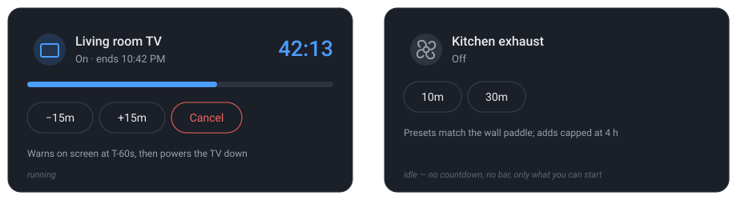
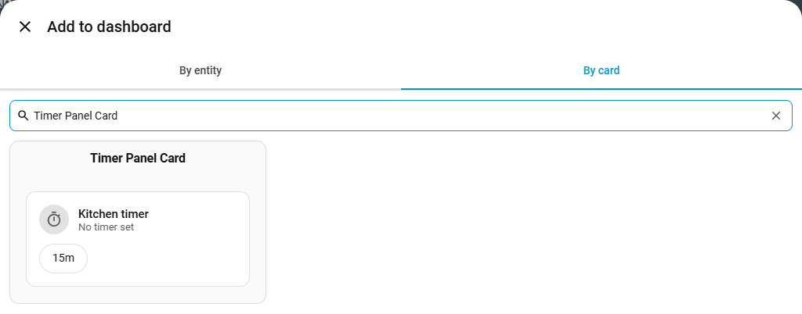
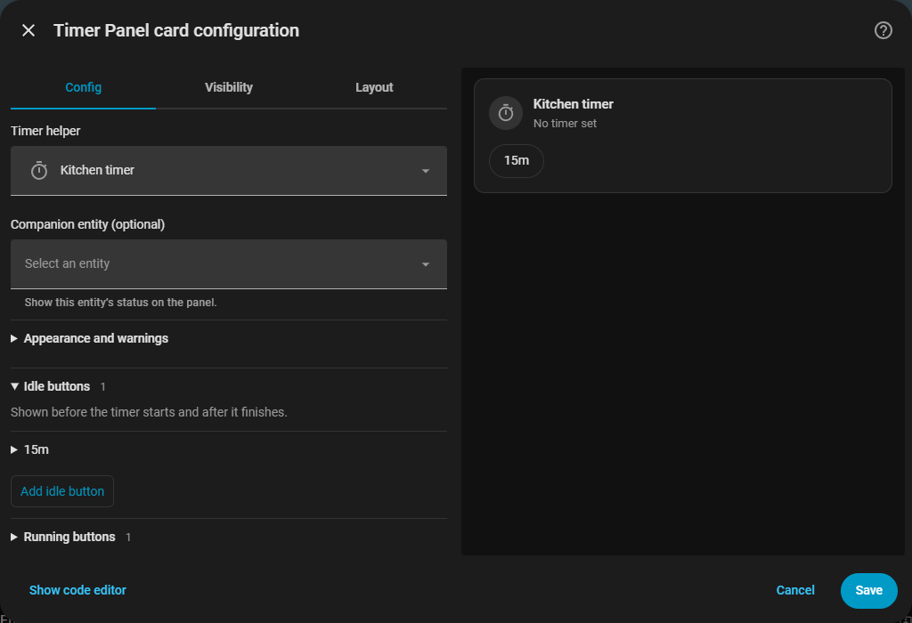

# Timer Panel Card

 

Give your Home Assistant timer a place on your dashboard: preset buttons when idle, a live
countdown and progress bar when running, and the device's status alongside it.

[Documentation wiki](https://github.com/JustBeanie/timer-panel-card/wiki) · [Quick start](#quick-start) · [Configuration](https://github.com/JustBeanie/timer-panel-card/wiki/Configuration) · [Examples](https://github.com/JustBeanie/timer-panel-card/wiki/Examples) · [Troubleshooting](https://github.com/JustBeanie/timer-panel-card/wiki/Troubleshooting)

**Before you start:** Home Assistant 2024.11 or newer and a Timer helper. Set up the panel in
the dashboard card picker. Device shutdown and notifications use separate Home Assistant automations.

## Quick start

### 1. Install the card

Timer Panel Card is included in the default catalog. **Marketplace is built into Home Assistant
2026.11 and newer**; on older versions, use HACS. Click the button above, or:

1. Open **Marketplace** (Home Assistant 2026.11+) or **HACS** on older versions.
2. Search for **Timer Panel Card** and open it.
3. Download the card, then refresh your browser.

Can't find it yet? [Refresh the catalog or add the repository manually](https://github.com/JustBeanie/timer-panel-card/wiki/Troubleshooting#cannot-find-the-card-in-hacs).
For advanced setups that manage JavaScript resources directly, see
[manual resource installation](https://github.com/JustBeanie/timer-panel-card/wiki/Troubleshooting#manual-resource-installation).

### 2. Choose a timer

Already have a Timer helper? Select it in the next step.

Otherwise, go to **Settings → Devices & services → Helpers → Create helper → Timer**. Give it a
name such as **Kitchen** and save it.

### 3. Add the panel

1. Edit your dashboard and choose **Add card**. Open **By card** if shown, then search for **Timer Panel Card**.
   Select the card to open its visual editor.

   

2. Select your **Timer helper**. You can also select a **Companion entity** to show its status.
3. Save the card. The default buttons start a 15-minute timer and cancel it.

   

**Try it:** press **15m**. The countdown and progress bar appear, and the preset becomes **Cancel**.
Tap the header to open Home Assistant's timer controls. Press **Cancel** to return to the preset.

If you see “Custom element doesn't exist” or “Entity not found,” follow the
[troubleshooting steps](https://github.com/JustBeanie/timer-panel-card/wiki/Troubleshooting).

## Help and contributing

- [Troubleshooting](https://github.com/JustBeanie/timer-panel-card/wiki/Troubleshooting)
- [Report a bug or suggest an improvement](https://github.com/JustBeanie/timer-panel-card/issues/new/choose)
- [Changelog](CHANGELOG.md)
- [Contributing](CONTRIBUTING.md)

## License

[MIT](LICENSE)
