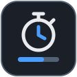

# Timer Panel Card

 

Give your Home Assistant timer a place on your dashboard: preset buttons when idle, a live
countdown and progress bar when running, and the device's status alongside it.

[Documentation wiki](https://github.com/JustBeanie/timer-panel-card/wiki) · [Quick start](https://github.com/JustBeanie/timer-panel-card/wiki/Quick-start) · [Configuration](https://github.com/JustBeanie/timer-panel-card/wiki/Configuration) · [Examples](https://github.com/JustBeanie/timer-panel-card/wiki/Examples) · [Troubleshooting](https://github.com/JustBeanie/timer-panel-card/wiki/Troubleshooting)

## Quick start

Requires Home Assistant 2024.11 or newer and a Timer helper.

1. Open **Marketplace** in Home Assistant 2026.11 or newer, or **HACS** on older versions. Search for **Timer Panel Card**, download it, then refresh your browser.
2. In your dashboard, select **Add card → Timer Panel Card**.
3. Choose your Timer helper and, optionally, a companion entity to show its status.

See the [quick-start guide](https://github.com/JustBeanie/timer-panel-card/wiki/Quick-start) for screenshots and setup details, or follow the [manual installation steps](https://github.com/JustBeanie/timer-panel-card/wiki/Troubleshooting#manual-resource-installation).

## Help and contributing

- [Troubleshooting](https://github.com/JustBeanie/timer-panel-card/wiki/Troubleshooting)
- [Report a bug or suggest an improvement](https://github.com/JustBeanie/timer-panel-card/issues/new/choose)
- [Changelog](CHANGELOG.md)
- [Contributing](CONTRIBUTING.md)

## License

[MIT](LICENSE)
